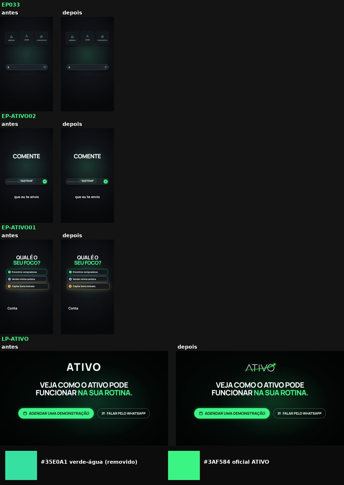

# Cores — antes × depois

Quadros renderizados do mesmo frame antes e depois da troca (escala 0,5):

| Composição | Frame | O que muda |
|---|---|---|
| EP033 (CTA) | 1150 | brilho de fundo e bordas dos módulos: verde-água → `#3AF584` |
| EP-ATIVO02 (CTA) | 2400 | glow do campo de comentário e botão |
| EP-ATIVO01 (CTA) | 2200 | bordas/brilhos das opções |
| LP-ATIVO v1 (CTA) | 3300 | marca tipográfica provisória → **logo oficial**; glows no verde oficial |

Observação: `C.accent` já era `#3AF584` desde o início da tarde (troca feita para o vídeo da landing), por isso nos Reels a diferença está nos brilhos, bordas e fundos de destaque que usavam o RGB antigo escrito à mão.

Prévia 9:16 com a logo oficial e áreas seguras do Instagram marcadas: `img/story01_previa_area_segura.jpg`. Vídeo 16:9 com logo oficial: `OUTPUT/LP_ATIVO_V3/` (não re-renderizado nesta tarefa).
